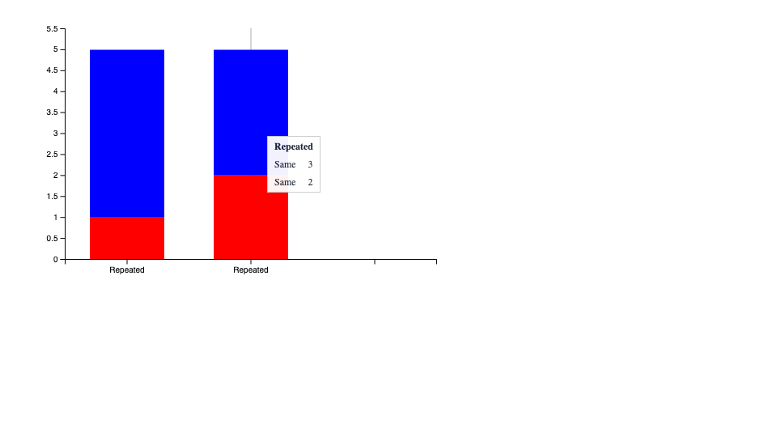
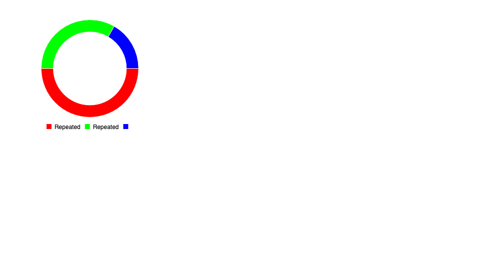

# Billboard 4 chart hover

Billboard's modular ESM entry exposes grid focus as a separate registration
function. Updating the PPTX chart capability to Billboard 4 without registering
that module preserves the bars but loses the hover focus line. The renderer now
registers `grid()` when the supplied chart library exports it. Custom or bundled
loaders that already provide the feature remain supported.

The self-contained fixture in
`packages/renderers/pptx/scripts/chart-fixture.mjs` produces a small three-slide
presentation. It requires no customer files, network resources, or external
fixture package. Run the actual parser, Worker, chart library, and browser checks
with:

```sh
pnpm --filter @file-viewer/pptx verify:chart-families
```

The browser verifies the tooltip and a visible focus line after a real mouse
hover at device pixel ratios 1 and 2. It also checks independent repeated series,
stacked and percentage-stacked bar geometry, doughnut hole ratios and authored
angles, resize behavior, zero/error/negative values, and viewer cleanup. The two
hover checks failed before the registration change. After the fix, all 25 browser
checks and the two chart metadata checks pass without external requests or
uncaught browser errors. No optional private sample was used for these results.





The text and Word Node tests use JSDOM 30. Its development-time Node
requirement is `^22.22.2 || ^24.15.0 || >=26.0.0`; these checks ran on Node 26.8.2.
This dependency update does not change the consumer runtime requirement. Modern
React packages use React 19 types, while both React 17 legacy packages retain
their React 17 types.
